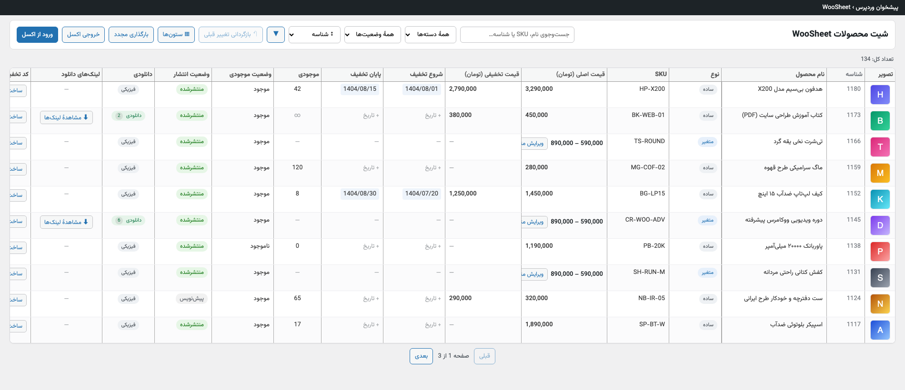
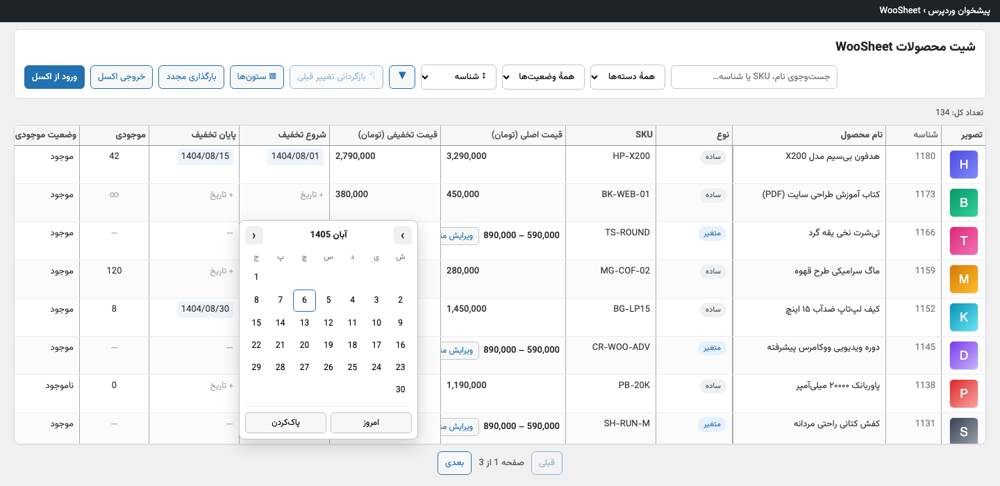
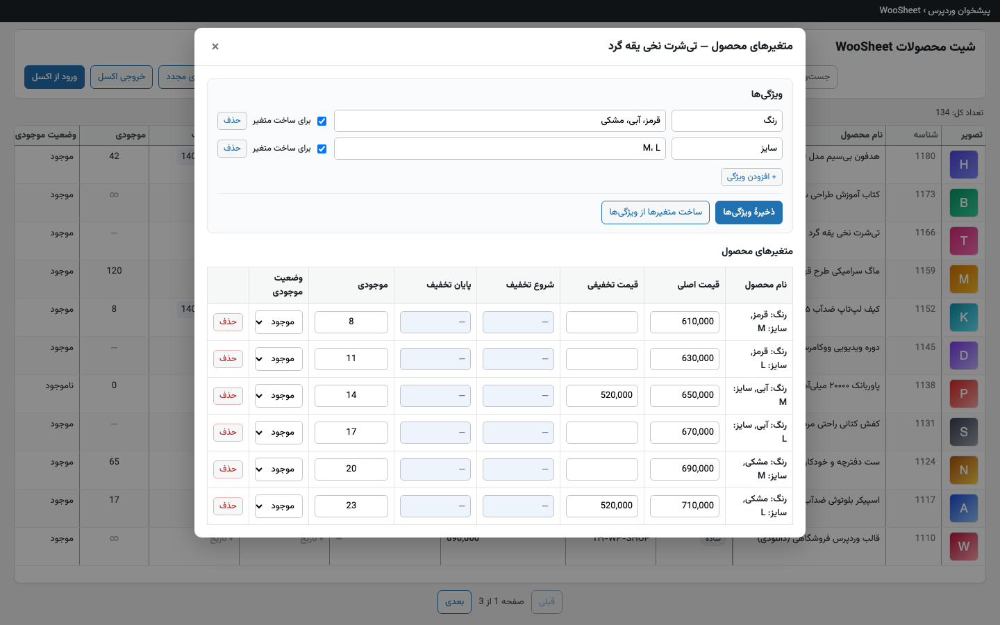
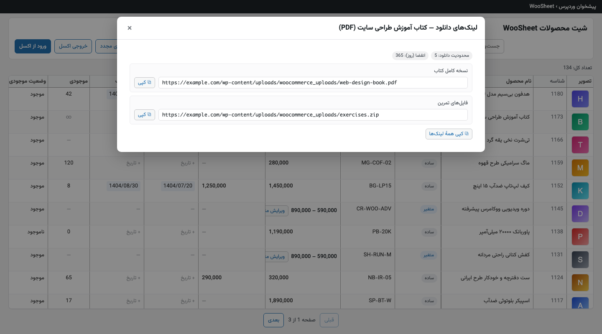
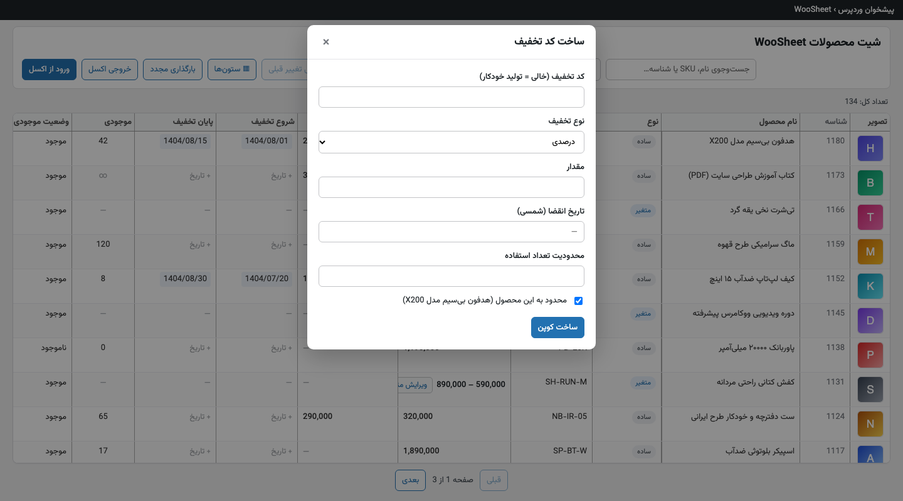
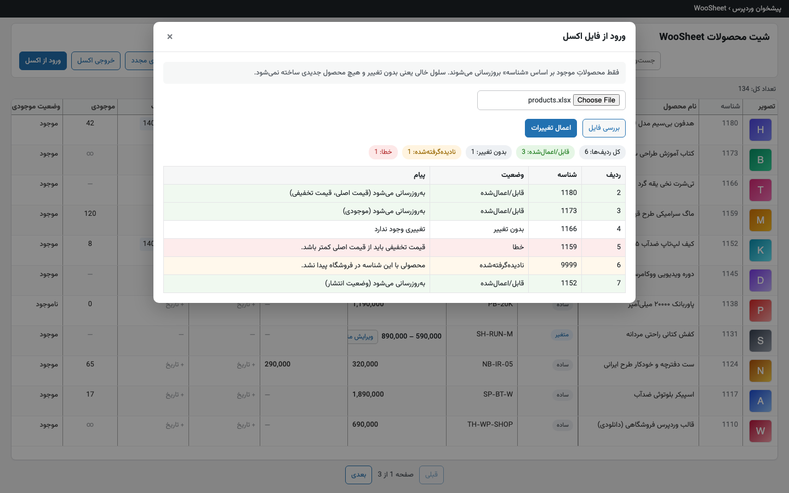

<div dir="rtl">

# WooSheet — مدیریت اکسلی محصولات ووکامرس

    

**WooSheet** یک افزونهٔ وردپرس برای ووکامرس است که همهٔ محصولات فروشگاه را در یک **جدول شبیه اکسل / گوگل‌شیت** نشان می‌دهد. قیمت، تخفیف، موجودی، وضعیت انتشار و بقیهٔ فیلدها را مستقیم داخل سلول تغییر می‌دهید و هر تغییر همان لحظه، با اعتبارسنجی سخت‌گیرانه، ذخیره می‌شود. دیگر لازم نیست برای عوض کردن قیمت ده‌ها محصول، صفحهٔ ویرایش تک‌تک آن‌ها را باز کنید.

رابط کاملاً **راست‌چین و فارسی** است، تقویم **شمسی** دارد و همهٔ منابع (فونت، کتابخانهٔ جدول، تقویم) **داخل خود افزونه** هستند؛ هیچ درخواستی به CDN یا سرویس خارجی ارسال نمی‌شود.



> تصاویر این راهنما از رابط واقعی افزونه با داده‌های نمونه گرفته شده‌اند.

---

## فهرست

- [امکانات](#امکانات)
- [نیازمندی‌ها](#نیازمندیها)
- [نصب](#نصب)
- [راهنمای استفاده](#راهنمای-استفاده)
  - [ویرایش سلول](#ویرایش-سلول)
  - [جست‌وجو، فیلتر و مرتب‌سازی](#جستوجو-فیلتر-و-مرتبسازی)
  - [تخفیف زمان‌دار با تقویم شمسی](#تخفیف-زماندار-با-تقویم-شمسی)
  - [محصولات متغیر](#محصولات-متغیر)
  - [لینک‌های دانلود](#لینکهای-دانلود)
  - [ساخت کد تخفیف](#ساخت-کد-تخفیف)
  - [خروجی و ورودی اکسل](#خروجی-و-ورودی-اکسل)
- [قواعد اعتبارسنجی](#قواعد-اعتبارسنجی)
- [سؤالات متداول](#سؤالات-متداول)
- [برای توسعه‌دهندگان](#برای-توسعهدهندگان)
- [مشارکت](#مشارکت)
- [مجوز و نویسنده](#مجوز-و-نویسنده)

---

## امکانات

| امکان | توضیح |
| --- | --- |
| **ویرایش درجا** | نام، SKU، نوع، موجودی، قیمت اصلی، قیمت تخفیفی، زمان تخفیف، وضعیت موجودی و وضعیت انتشار را مستقیم در سلول عوض کنید. |
| **ذخیرهٔ خودکار** | هر تغییر فوراً ذخیره می‌شود. سلول هنگام ذخیره زرد، در موفقیت سبز و در خطا قرمز می‌شود. |
| **بازگردانی** | دکمهٔ «بازگردانی تغییر قبلی» آخرین ویرایش را برمی‌گرداند. |
| **محصولات متغیر** | ویژگی‌ها را تعریف کنید، متغیرها را بسازید و قیمت، تخفیف و موجودی هر متغیر را در یک پاپ‌آپ ویرایش کنید. |
| **تقویم شمسی** | زمان شروع و پایان تخفیف با تقویم جلالی انتخاب می‌شود و در پس‌زمینه به فرمت ووکامرس ذخیره می‌گردد. |
| **کد تخفیف سریع** | با یک کلیک برای هر محصول کوپن بسازید، مخصوص همان محصول یا عمومی. |
| **تصویر شاخص** | تصویر محصول را از کتابخانهٔ رسانهٔ وردپرس عوض کنید. |
| **لینک‌های دانلود** | لینک و تعداد فایل‌های دانلودی هر محصول (و هر متغیر) را ببینید و کپی کنید. |
| **ستون‌های قابل تنظیم** | هر ستونی که لازم ندارید را پنهان کنید. |
| **جست‌وجو و فیلتر** | جست‌وجو با نام، SKU یا شناسه؛ فیلتر بر اساس دسته و وضعیت انتشار؛ مرتب‌سازی سمت سرور. |
| **خروجی و ورودی xlsx** | از همهٔ محصولات فایل اکسل بگیرید، آنجا ویرایش کنید و با گزارش پیش‌نمایش دوباره وارد فروشگاه کنید. |
| **ورودی فارسی** | ارقام فارسی، عربی و انگلیسی و جداکنندهٔ هزارگان همه پذیرفته می‌شوند. |
| **کاملاً محلی** | فونت وزیرمتن، Tabulator و تقویم شمسی همراه افزونه‌اند. بدون CDN، بدون فونت گوگل. |
| **ایمن** | نوشتن فقط از راه WooCommerce CRUD؛ دسترسی با قابلیت `manage_woocommerce` و nonce وردپرس؛ سازگار با HPOS. |

## نیازمندی‌ها

- وردپرس **۶.۰** یا بالاتر (تست‌شده با ۶.۸)
- ووکامرس **۶.۰** یا بالاتر، فعال (تست‌شده با ۹.۹)
- PHP **۷.۴** یا بالاتر
- افزونه‌های PHP: `ZipArchive` و `DOMDocument` (در بیشتر هاست‌ها فعال‌اند؛ برای خروجی/ورودی اکسل لازم‌اند)

نیازی به Composer، npm یا ابزار جانبی نیست؛ افزونه از اول آمادهٔ اجراست.

## نصب

### روش اول: آپلود از پیشخوان وردپرس

1. مخزن را دانلود کنید (**Code ← Download ZIP**)، از حالت فشرده خارج کنید و پوشهٔ `woosheet/` (همان که `woosheet.php` داخلش است) را جداگانه زیپ کنید.
2. در پیشخوان: **افزونه‌ها ← افزودن ← بارگذاری افزونه** و فایل زیپ را انتخاب کنید.
3. افزونه را **فعال** کنید.

### روش دوم: کپی دستی یا Git

```bash
cd wp-content/plugins
git clone https://github.com/hoomanjamshidi/WooSheet.git woosheet-repo
cp -r woosheet-repo/woosheet ./woosheet
```

سپس از صفحهٔ «افزونه‌ها» فعالش کنید.

### شروع کار

بعد از فعال‌سازی، از منوی پیشخوان روی **WooSheet** کلیک کنید. اگر ووکامرس فعال نباشد، افزونه یک اعلان نشان می‌دهد و بارگذاری نمی‌شود.

> **واحد پول:** قیمت‌ها از تنظیمات واحد پول ووکامرس پیروی می‌کنند. برای تومان معمولاً تعداد اعشار را روی صفر بگذارید.

## راهنمای استفاده

### ویرایش سلول

روی سلول کلیک کنید، مقدار را عوض کنید و `Enter` بزنید یا از سلول خارج شوید. تغییر بلافاصله ذخیره می‌شود.
اگر مقدار نامعتبر باشد (مثلاً قیمت تخفیفی بیشتر از قیمت اصلی)، تغییر اعمال نمی‌شود، سلول به مقدار قبلی برمی‌گردد و پیام خطا به فارسی در یک توست نمایش داده می‌شود.

### جست‌وجو، فیلتر و مرتب‌سازی

- کادر جست‌وجو: نام، SKU یا شناسهٔ محصول.
- فیلتر «همهٔ دسته‌ها» و «همهٔ وضعیت‌ها».
- فهرست مرتب‌سازی کنار ابزارها (شناسه، نام، قیمت، موجودی، دانلودی، جدیدترین) و دکمهٔ تغییر جهت. مرتب‌سازی روی کل فروشگاه انجام می‌شود، نه فقط صفحهٔ جاری.
- دکمهٔ **▦ ستون‌ها** برای نمایش و پنهان‌کردن ستون‌ها.

### تخفیف زمان‌دار با تقویم شمسی

روی سلول «شروع تخفیف» یا «پایان تخفیف» کلیک کنید تا تقویم جلالی باز شود. گزینهٔ «امروز» و «پاک‌کردن» هم دارد.



تاریخ پایان نمی‌تواند قبل از تاریخ شروع باشد.

### محصولات متغیر

قیمت محصول متغیر مستقیم روی خودش ویرایش نمی‌شود؛ بازهٔ قیمت متغیرها نمایش داده می‌شود و با کلیک روی دکمهٔ «ویرایش متغیرها» پاپ‌آپ باز می‌شود:

1. یک **ویژگی** تعریف کنید؛ مثلاً «رنگ» با مقادیر «قرمز، آبی، مشکی» (با کاما جدا کنید) و گزینهٔ «برای ساخت متغیر» را تیک بزنید.
2. **ذخیرهٔ ویژگی‌ها** و سپس **ساخت متغیرها از ویژگی‌ها** را بزنید. ترکیب‌های تکراری دوباره ساخته نمی‌شوند.
3. قیمت اصلی، قیمت تخفیفی، بازهٔ تخفیف و موجودی هر متغیر را مستقیم در جدول پاپ‌آپ ویرایش کنید. هر متغیر دکمهٔ حذف دارد.



تبدیل نوع محصول از «ساده» به «متغیر» هم از ستون «نوع» ممکن است؛ در این حالت پاپ‌آپ متغیرها خودکار باز می‌شود.

### لینک‌های دانلود

برای محصولات دانلودی، ستون «لینک‌های دانلود» دکمهٔ «مشاهدهٔ لینک‌ها» دارد. نام فایل‌ها، آدرس هر فایل، محدودیت دانلود و مهلت انقضا نشان داده می‌شود و می‌توانید هر لینک یا همهٔ لینک‌ها را کپی کنید. برای محصول متغیر، لینک‌ها به تفکیک هر متغیر در یک آکاردئون می‌آیند.



### ساخت کد تخفیف

ستون «کد تخفیف» دکمهٔ «ساخت کوپن» دارد. نوع تخفیف (درصدی، مبلغ ثابت سبد یا مبلغ ثابت محصول)، مقدار، تاریخ انقضای شمسی و محدودیت تعداد استفاده را بدهید. اگر کد را خالی بگذارید، به‌صورت خودکار تولید می‌شود و با تیک «محدود به این محصول» فقط روی همان محصول کار می‌کند.



### خروجی و ورودی اکسل

**خروجی:** دکمهٔ «خروجی اکسل» همهٔ محصولات (و متغیرها) را به‌صورت فایل `.xlsx` دانلود می‌کند. ستون‌ها:

`شناسه · شناسهٔ والد · نوع · نام محصول · SKU · قیمت اصلی · قیمت تخفیفی · شروع تخفیف (شمسی) · پایان تخفیف (شمسی) · موجودی · وضعیت موجودی · وضعیت انتشار · دسته‌ها · لینک محصول`

**ورودی:**

1. اول خروجی بگیرید و فایل را در اکسل ویرایش کنید. فقط مقادیر را تغییر دهید و **ستون «شناسه» را دست نزنید.**
2. «ورود از اکسل» را بزنید، فایل را انتخاب کنید و **«بررسی فایل»** را بزنید. گزارش پیش‌نمایش نشان می‌دهد چه ردیف‌هایی اعمال می‌شوند، کدام بدون تغییرند، کدام نادیده گرفته می‌شوند و کدام خطا دارند. هنوز چیزی تغییر نکرده است.
3. اگر گزارش درست بود، **«اعمال تغییرات»** را بزنید.



نکات مهم:

- **محصول جدید نمی‌سازد.** فقط محصولات موجود را بر اساس شناسه به‌روز می‌کند؛ بنابراین هیچ محصول تکراری ایجاد نمی‌شود. ردیفی که شناسهٔ معتبر ندارد نادیده گرفته می‌شود و در گزارش می‌آید.
- **سلول خالی یعنی «بدون تغییر».** برای پاک‌کردن یک مقدار (مثلاً حذف تخفیف) آن را از خود شیت پاک کنید.
- همان قواعد اعتبارسنجی شیت برای ورودی اکسل هم اعمال می‌شود.

## قواعد اعتبارسنجی

این قواعد عمداً سخت‌گیرانه‌اند تا قیمت اشتباه وارد فروشگاه نشود:

- قیمت تخفیفی باید **کوچک‌تر** از قیمت اصلی باشد.
- تخفیف بدون قیمت اصلی مجاز نیست.
- تاریخ شروع تخفیف باید قبل یا برابر تاریخ پایان باشد.
- قیمت محصول متغیر فقط از مسیر متغیرهایش تغییر می‌کند.
- ورودی عددی با ارقام فارسی/عربی/انگلیسی و جداکنندهٔ هزارگان پذیرفته و نرمال می‌شود.

## سؤالات متداول

**آیا تغییرات مستقیم در دیتابیس نوشته می‌شود؟**
نه. همهٔ نوشتن‌ها از طریق WooCommerce CRUD (`set_*()` و `save()`) انجام می‌شود تا کش قیمت‌ها، جدول‌های جست‌وجو و قیمت محصولات متغیر درست به‌روز شوند.

**چه کسانی به صفحه دسترسی دارند؟**
کاربرانی که قابلیت `manage_woocommerce` دارند (مدیر فروشگاه و مدیر کل). با فیلتر `woosheet_capability` می‌توانید این را عوض کنید:

```php
add_filter( 'woosheet_capability', function () {
	return 'edit_products';
} );
```

**آیا با HPOS سازگار است؟**
بله، سازگاری با ذخیره‌سازی سفارش‌های سفارشی ووکامرس اعلام شده است.

**با تعداد زیاد محصول کند نمی‌شود؟**
فهرست صفحه‌بندی شده (۵۰ محصول در هر صفحه) و مرتب‌سازی و فیلتر سمت سرور است. اطلاعات دانلودی‌ها و متغیرها برای کل صفحه با یک کوئری گرفته می‌شود.

**روی هاست http (بدون SSL) کار می‌کند؟**
بله. حتی دکمهٔ کپی لینک‌ها در اتصال ناامن هم با روش جایگزین کار می‌کند.

**آیا چیزی به سرور بیرونی ارسال می‌شود؟**
خیر. هیچ تماس بیرونی، ردیابی یا CDN‌ای وجود ندارد.

## برای توسعه‌دهندگان

### ساختار

```text
woosheet/
├── woosheet.php                              بوت‌استرپ، ثابت‌ها، بررسی فعال‌بودن ووکامرس، اعلام سازگاری HPOS
├── includes/
│   ├── class-woosheet.php                    سینگلتون و WooSheet::capability()
│   ├── class-woosheet-admin.php              منو، enqueue، داده و رشته‌های i18n برای JS، خروجی اکسل
│   ├── class-woosheet-rest.php               ثبت روت‌های REST در woosheet/v1
│   ├── class-woosheet-products-controller.php  لیست، مرتب‌سازی، متغیرها، ویژگی‌ها، دانلودها، batch
│   ├── class-woosheet-coupons-controller.php   ساخت کوپن
│   ├── class-woosheet-product-mapper.php     نگاشت محصول ↔ ردیف، اعتبارسنجی و اعمال تغییرات
│   ├── class-woosheet-export.php             تعریف ستون‌های xlsx و استریم دانلود
│   ├── class-woosheet-import.php             اعتبارسنجی و اعمال فایل xlsx
│   ├── class-woosheet-xlsx.php               خواندن/نوشتن xlsx بدون کتابخانهٔ بیرونی
│   └── class-woosheet-jalali.php             تبدیل شمسی↔میلادی و نرمال‌سازی ارقام
├── templates/admin-page.php                  اسکلت صفحه
└── assets/
    ├── js/woosheet.js                        کل منطق رابط کاربری (ES5، یک IIFE)
    ├── js/jalali-datepicker.js               تقویم شمسی
    ├── js/tabulator.min.js                   وندور
    ├── css/                                  woosheet.css، vazir.css، tabulator.min.css (وندور)
    └── fonts/                                وزیرمتن
```

### REST API

همهٔ روت‌ها زیر `/wp-json/woosheet/v1/` هستند و به قابلیت مدیریتی و هدر `X-WP-Nonce` نیاز دارند.

| روت | توضیح |
| --- | --- |
| `GET /products` | فهرست صفحه‌بندی‌شده (`page`, `per_page`, `search`, `orderby`, `order`, `category`, `status`) |
| `POST /products/{id}` | ویرایش فیلدهای یک محصول: `{ "fields": { ... } }` |
| `POST /products/batch` | ویرایش گروهی |
| `POST /products/{id}/type` | تغییر نوع (ساده ↔ متغیر) |
| `GET /products/{id}/variations` | متغیرها و ویژگی‌ها |
| `POST /products/{id}/attributes` | ذخیرهٔ ویژگی‌ها |
| `POST /products/{id}/generate-variations` | ساخت متغیرها از ویژگی‌ها |
| `POST` / `DELETE /products/{id}/variations/{variation_id}` | ویرایش و حذف متغیر |
| `GET /products/{id}/downloads` | لینک‌های دانلود (به تفکیک متغیر) |
| `POST /coupons` | ساخت کوپن |
| `POST /import/validate` و `/import/commit` | بررسی و اعمال فایل xlsx (`multipart`، فیلد `file`) |

### قواعد کدنویسی

- نوشتن در محصول فقط با WooCommerce CRUD؛ بعد از تغییر قیمت یا موجودی متغیر، `WC_Product_Variable::sync()` صدا زده شود. از `update_post_meta` مستقیم استفاده نکنید.
- خطاها `WP_Error` با `array( 'status' => 4xx )` و **پیام فارسی قابل‌فهم** باشند؛ همین پیام در توست نمایش داده می‌شود.
- PHP با استاندارد WordPress (تب، `array()`، Yoda، docblock فارسی). JavaScript به سبک ES5 (بدون `let`، arrow function و template literal).
- هر ورودی عددی کاربر از `WooSheet_Jalali::normalize_digits()` رد شود.
- منبع بیرونی (CDN، فونت گوگل) اضافه نکنید.
- فایل‌های `tabulator.min.js` و `tabulator.min.css` وندور هستند؛ ویرایش نکنید.

### افزودن ستون یا فیلد

- **فیلد جدید برای ردیف:** در `product_to_row()` و `variation_to_row()` در `class-woosheet-product-mapper.php` اضافه کنید. ستون‌های اکسل جدا هستند و از `WooSheet_Export::columns()` می‌آیند.
- **ستون جدید شیت:** یک عضو در `buildColumns()` در `woosheet.js` و یک کلید `col*` در `WooSheet_Admin::get_i18n()`.
- **روت REST جدید:** متد را در کنترلر بنویسید و در `class-woosheet-rest.php` با `permission_callback` ثابت ثبت کنید.

جزئیات بیشتر معماری در [CLAUDE.md](CLAUDE.md) آمده است.

### بررسی سریع و تست

پروژه تست خودکار ندارد. حداقل بررسی سینتکس:

```bash
cd woosheet
for f in woosheet.php includes/*.php templates/*.php; do php -l "$f"; done
node --check assets/js/woosheet.js
```

برای تست واقعی، پوشهٔ `woosheet/` را داخل `wp-content/plugins/` یک نصب ووکامرس قرار دهید. نسخهٔ فایل‌های استاتیک با `filemtime` کش‌شکنی می‌شود، پس بعد از ویرایش JS/CSS نیازی به تغییر `WOOSHEET_VERSION` نیست.

## مشارکت

Issue و Pull Request خوش‌آمد است. لطفاً قبل از ارسال، قواعد کدنویسی بالا را رعایت کنید، سینتکس را بررسی کنید و در توضیح تغییر بنویسید روی چه نسخه‌ای از وردپرس و ووکامرس تست کرده‌اید.

## مجوز و نویسنده

منتشرشده با مجوز **GPLv2 یا هر نسخهٔ بعدی آن**.

نویسنده: [هومن جمشیدی](https://hoomanjamshidi.ir)

</div>
